# Plinius, your tourist guide

## 1. Overview

Plinius is an AI agent system that lets users converse with their guide through natural, real-time voice. Powered by Retrieval-Augmented Generation (RAG), it grounds every answer in curated knowledge, delivering accurate and relevant responses for this use case.

Designed for visitors to Rome, Plinius serves as a tourist guide through the city's historic sites. It is named in honour of Pliny the Elder, the renowned Roman historian (yes, the author is a history geek too).

## 2. Use Case and Business Value

Organizations need answers they can trust, grounded in what users actually ask. Voice interaction increasingly strengthens that experience, but only when it can be governed with precision.

Plinius provides an infrastructure that gives organizations control over both fronts:

- **Pipeline control:** how each layer works, namely Speech-to-Text (STT), the Large Language Model (LLM) and Text-to-Speech (TTS).
- **Context control:** the specific context used within a real-time voice application.
- **Source traceability:** users can consult the sources behind each answer.

## 3. Prerequisites and Installation Guide

This section describes the complete flow to run Plinius locally and to deploy it to the cloud.

### 3.1 Prerequisites

| Tool | Purpose | Notes |
| --- | --- | --- |
| [uv](https://docs.astral.sh/uv/) | Python environment and dependency management | Backend requires Python 3.10 or later |
| Node.js and npm | Frontend build and development server | The container image builds with Node 24 |
| Gemini API key | LLM and embeddings | Google AI Studio key, held server-side only |
| Docker | Container image build | Cloud deployment only |
| Google Cloud account and `gcloud` CLI | Cloud Storage, Cloud Run, Secret Manager, Artifact Registry | Cloud deployment only |
| Qdrant instance | Vector retrieval in cloud mode | Cloud deployment only |

### 3.2 Configuration

The application runs in one of two modes, selected with the `ENV` variable:

| Mode | Prompts | Retrieval | Source PDFs |
| --- | --- | --- | --- |
| `LOCAL` | Local YAML files | SQLite snapshot | Local document corpus |
| `GCP` | Google Cloud Storage | Qdrant collection `historic_guide` | Google Cloud Storage |

Configuration is resolved in this order: process environment, the `APP_SECRETS_JSON` secret, the root `.env` file, then defaults. Create the root `.env` from the provided template:

```sh
cp .env.sample .env
```

| Variable | Description |
| --- | --- |
| `ENV` | `LOCAL` or `GCP` (defaults to `LOCAL`) |
| `GEMINI_API_KEY` | Gemini API key (required) |
| `LLM_MODEL` | Generation model |
| `EMBEDDING_MODEL` | Embedding model; must match the one used to build the knowledge base |
| `GCS_BUCKET`, `GOOGLE_CLOUD_PROJECT` | Cloud Storage bucket and Google Cloud project (`GCP` mode) |
| `GOOGLE_APPLICATION_CREDENTIALS` | Service account key path, for local development only |
| `QDRANT_HOST`, `QDRANT_PORT`, `QDRANT_URL`, `QDRANT_COLLECTION`, `QDRANT_API_KEY` | Qdrant connection (`GCP` mode); `QDRANT_URL` takes precedence over host and port |
| `LOG_LEVEL`, `LOG_FORMAT` | Logging level and format (`json` or `text`) |

Never commit `.env` files or service account keys.

### 3.3 Local Deployment

1. **Build the knowledge base.** Place the PDFs under `database/docs/<stop>/<type>/` and generate the SQLite snapshot (requires `GEMINI_API_KEY` and `EMBEDDING_MODEL`):

   ```sh
   uv run database/scripts/provisional_db_gen.py
   ```

2. **Install and start the backend** from the repository root (set `ENV=LOCAL` in `.env`):

   ```sh
   uv sync --project backend --locked
   uv run --project backend --locked uvicorn src.app:app --app-dir backend --port 8000 --reload
   ```

   The API is available at `http://127.0.0.1:8000`, with interactive documentation at `/docs` and a health check at `/health`.

3. **Install and start the frontend** in a second terminal:

   ```sh
   cd frontend
   npm ci
   npm run dev
   ```

   The Vite development server proxies `/api` requests to the backend on port 8000.

4. **Run the tests** (optional):

   ```sh
   ENV=LOCAL uv run --project backend --locked python -m unittest discover -s backend/tests
   npm --prefix frontend test
   ```

### 3.4 Cloud Deployment

Plinius is deployed as a single container, serving the React frontend at `/` and the FastAPI backend at `/api`, on Google Cloud Run.

1. **Publish the knowledge base to Cloud Storage.** Preview first, then upload the PDFs and prompts:

   ```sh
   uv run scripts/migrate_bucket.py --dry-run
   uv run scripts/migrate_bucket.py --bucket historic-guide
   ```

2. **Migrate the embeddings to Qdrant** (reaching Qdrant through a private network or authorized tunnel):

   ```sh
   uv run scripts/migrate_to_qdrant.py --dry-run
   uv run scripts/migrate_to_qdrant.py --url http://127.0.0.1:6333
   ```

3. **Build the container image** from the repository root:

   ```sh
   docker build --platform linux/amd64 -t historicguide:local .
   ```

   The image defaults to `ENV=GCP`, listens on port `8080` and runs as a non-root user. Secrets are never passed as build arguments.

4. **Provide runtime configuration.** On Cloud Run, attach the runtime service account and rely on Application Default Credentials. The settings in section 3.2 are supplied through the single `historicguide-secrets` JSON secret, exposed as `APP_SECRETS_JSON`.

5. **Provision and deploy the infrastructure.** Cloud resources are managed with Terraform and deployed through the GitHub Actions workflow: merge a same-repository `dev` pull request into `main`, then review and approve the saved plan in the protected `prod` environment. The one-time Google Cloud bootstrap and the full procedure are described in the [infrastructure guide](infra/README.md).

6. **Verify the deployment.** `/api/health` confirms the service is running, and `/api/demo/ready` confirms that the knowledge base is ready for chat.

## 4. Tech Stack

Plinius is built on three main pillars:

1. **Backend: Python and FastAPI.** The backend is implemented in Python with FastAPI. Utilities, agent memory and agent workflow are handled by custom classes, and no agent framework is used, which gives full control over how the system behaves. The LLM is accessed through the Google AI Studio (Gemini) API.
2. **Frontend: React and Vite.** The user interface is a React application, built and served with Vite.
3. **Cloud: Google Cloud Platform and Terraform.** The application is deployed on Google Cloud Platform (GCP), with the infrastructure defined as code using Terraform.

## 5. Voice Processing

Voice capabilities are provided by custom classes that make up the voice processing pipeline:

1. **Speech-to-Text (STT):** transcribes the user's speech into text.
2. **LLM agent:** sits in the middle of the pipeline, processing the transcribed text and generating the answer.
3. **Text-to-Speech (TTS):** converts the answer into voice output.

The STT and TTS layers can be activated or deactivated with a request parameter (`mode`), so the same endpoint can serve voice or text experiences:

| Mode | Input | Output | Layers active |
| --- | --- | --- | --- |
| `full` | Audio | Audio | STT, LLM, TTS |
| `stt` | Audio | Text | STT, LLM |
| `tts` | Text | Audio | LLM, TTS |
| `text` | Text | Text | LLM |

### 5.1 Pipeline Flow

Each request enters the same pipeline. The `mode` parameter determines whether the STT and TTS layers are executed around the LLM agent.

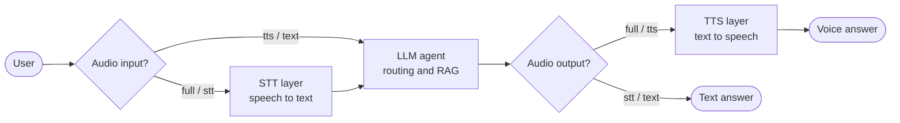

### 5.2 Request Sequence

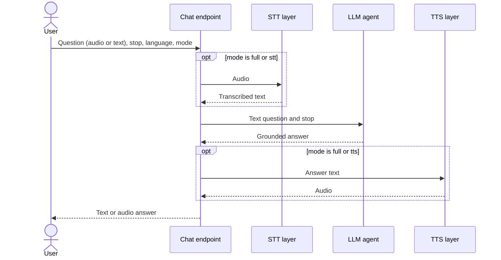

## 6. RAG Agent

The LLM agent uses Retrieval-Augmented Generation (RAG) to ground its answers in the knowledge base. Each document chunk is stored in a collection with the **stop name** and the **type** (for example, historic or restaurants) as metadata, alongside the document information.

For every request, the agent receives the current stop and extracts the user's intent from the question. That intent selects the type, so the query targets exactly the right metadata: the right stop and the right kind of content.

### 6.1 Retrieval Flow

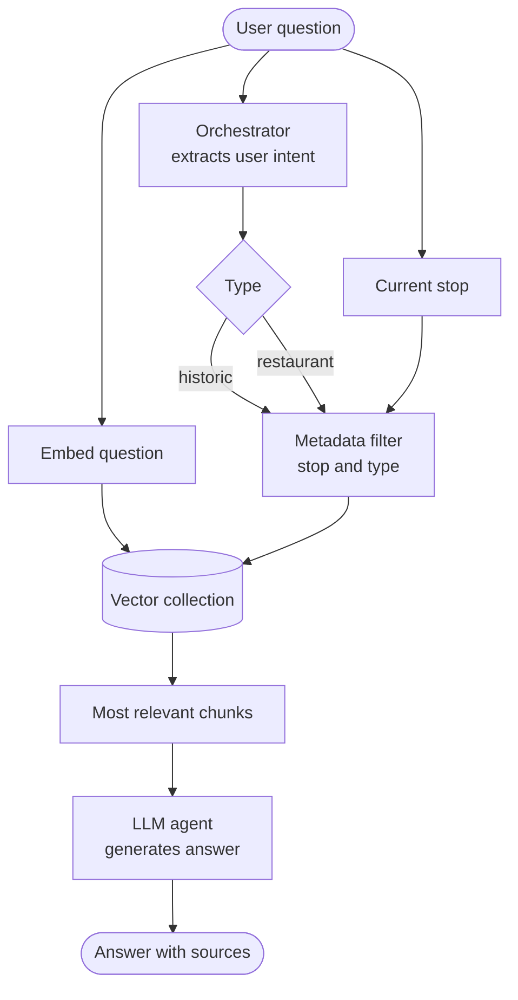

### 6.2 Knowledge Base Structure

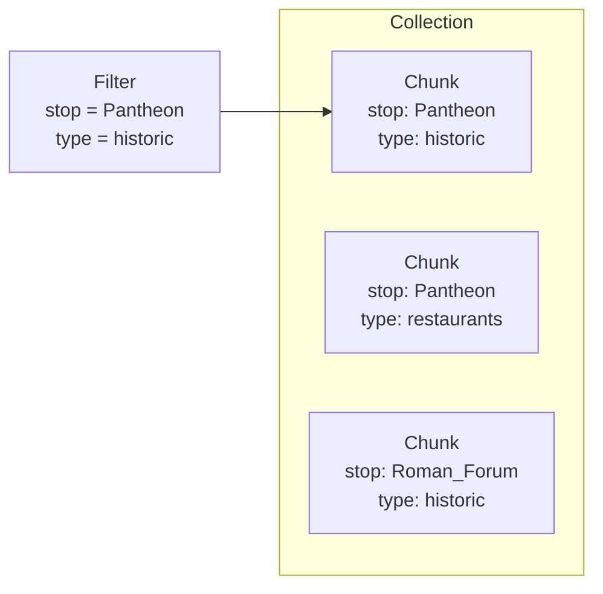

### 6.3 Agent Sequence

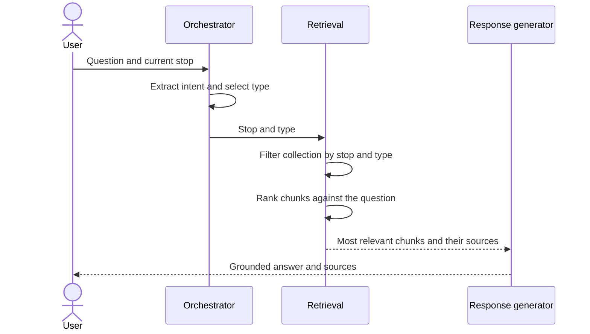

## 7. FastAPI Endpoints

The backend exposes a small, documented REST API. Locally the routes are served at the root of the backend (`http://127.0.0.1:8000`); in the Cloud Run container the same API is mounted under the `/api` prefix, alongside the frontend served at `/`.

### 7.1 Endpoint Overview

| Method | Path | Purpose | Response |
| --- | --- | --- | --- |
| `GET` | `/health` | Liveness check of the API process | JSON |
| `POST` | `/chat` | Generates a guide answer from text or audio | JSON, WAV audio or NDJSON stream |
| `GET` | `/documents/{source}` | Opens a source PDF cited by an answer | PDF |
| `GET` | `/demo/ready` | Checks that the knowledge base is ready for chat | JSON |
| `POST` | `/demo/start` | Requests on-demand startup of the vector database VM | JSON |

Interactive documentation is generated automatically: Swagger UI at `/docs`, ReDoc at `/redoc` and the OpenAPI schema at `/openapi.json` (under `/api` in the container). The endpoints require no client authentication; `GEMINI_API_KEY` is server-side configuration and is never sent by clients.

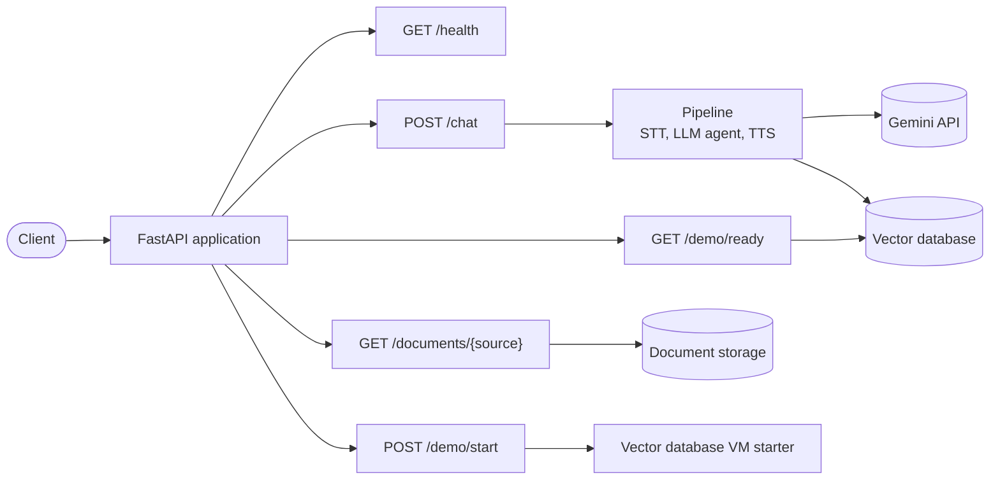

### 7.2 Health: `GET /health`

Returns `{"status":"ok"}` with HTTP 200. It is a liveness check only: it makes no external calls and does not confirm that Gemini or the chat pipeline are ready.

### 7.3 Chat: `POST /chat`

Accepts `multipart/form-data`.

| Field | Required | Values |
| --- | --- | --- |
| `query` | Yes | Text for `text` and `tts`, or an audio file (`audio/*`, at most 14,000,000 bytes) for `stt` and `full` |
| `mode` | Yes | `text`, `stt`, `tts`, `full` |
| `language` | Yes | `EN` or `ES` (answer language) |
| `stop` | Yes | Nonempty tour stop name, such as `Pantheon` |
| `request_type` | No | `historic` or `restaurant`; omit to classify the intent automatically |
| `stream` | No | `true` returns progress and the answer as NDJSON (default `false`) |

**Responses**

| Mode | Output | Content type |
| --- | --- | --- |
| `text`, `stt` | `{"text": "...", "sources": [...]}` | `application/json` |
| `tts`, `full` | WAV audio, with sources in the `X-PDF-Sources` header | `audio/wav` |
| Any mode with `stream=true` | One JSON event per line | `application/x-ndjson` |

Every answer includes its `sources`: PDF paths relative to the document corpus and one-based page numbers. Streamed responses emit `progress` events (`starting`, `transcribing`, `routing`, `retrieving`, `generating`, `synthesizing`; only executed stages appear), followed by a `result` event with `text`, or base64 `audio` and `mime_type`. A failure after streaming has started is reported as an explicit `error` event.

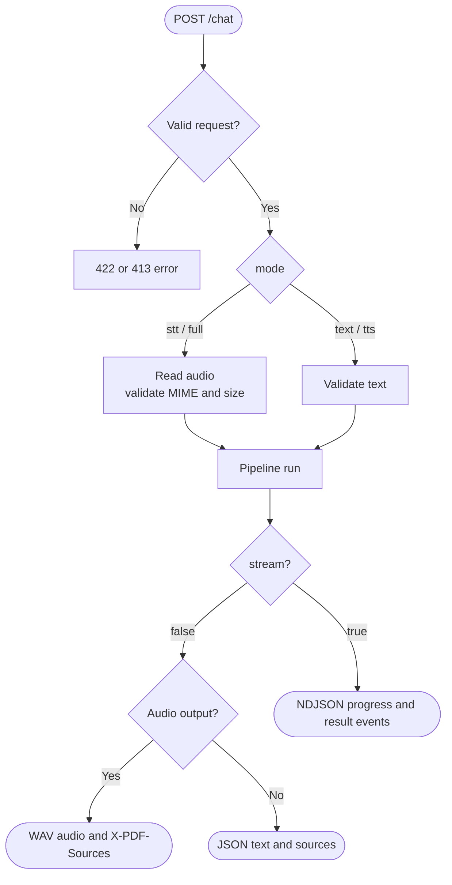

### 7.4 Documents: `GET /documents/{source}`

Opens the PDF referenced in an answer's `sources`, inline and with HTTP byte-range support. In `LOCAL` mode the file is read from the local corpus; in `GCP` mode it is proxied from Cloud Storage, so no signed URLs are exposed. Unsafe paths, non-PDF files and missing documents return `404`.

### 7.5 Demo readiness: `/demo/ready` and `/demo/start`

These endpoints let the frontend wake and monitor the vector database that backs retrieval.

| Endpoint | Behavior |
| --- | --- |
| `GET /demo/ready` | Checks Qdrant and the configured collection without starting anything; returns `200` when ready, `503` otherwise |
| `POST /demo/start` | Requests startup of the shared VM; returns `202` while starting, `200` when ready (always in `LOCAL` mode), `503` on failure |

Both return a `DemoStatus` body:

| Field | Values |
| --- | --- |
| `status` | `ready`, `starting`, `waiting`, `unavailable` |
| `reason` | `unreachable`, `collection_missing`, `collection_empty`, `collection_incompatible`, `configuration`, `startup_failed` (when applicable) |
| `retryable` | `true` if retrying may help |

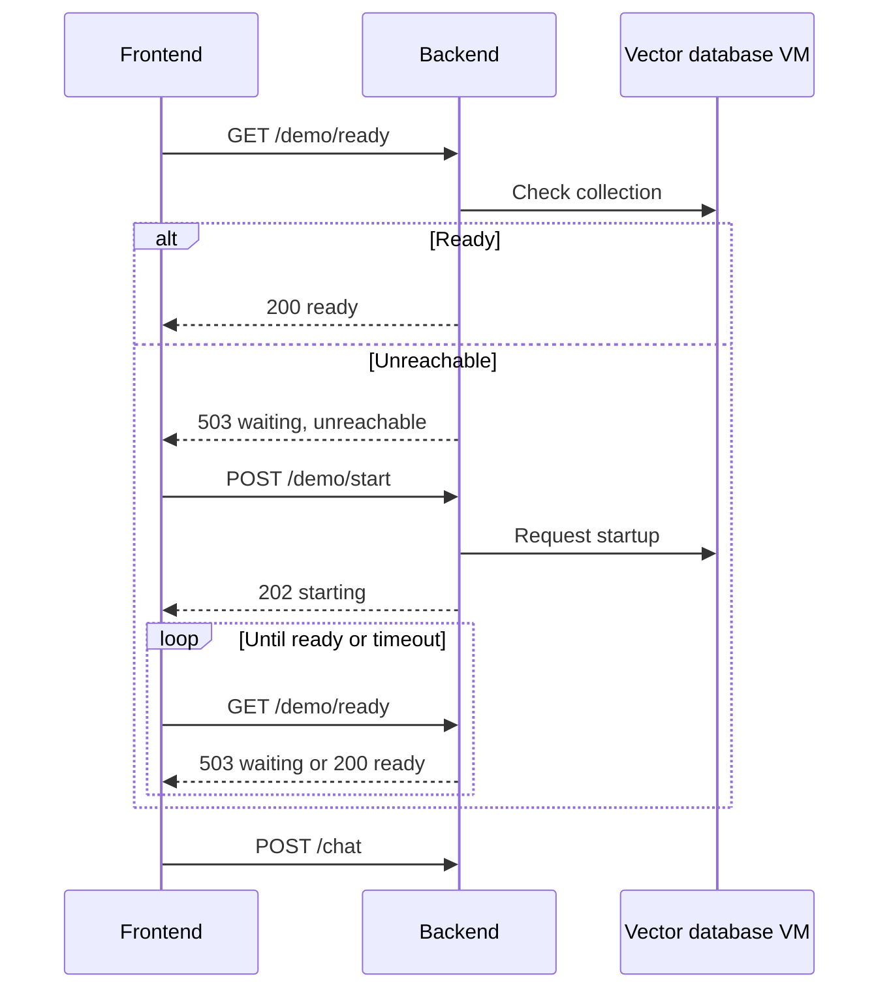

### 7.6 Errors and Tracing

| Status | Meaning |
| --- | --- |
| `400` | The multipart body could not be parsed |
| `404` | Source PDF not found |
| `413` | Uploaded audio exceeds 14,000,000 bytes |
| `422` | A field is missing or invalid, or the input does not match the mode |
| `500` | Unhandled failure; returns `{"detail":"Internal Server Error"}` |
| `503` | Vector database not ready (`/demo` endpoints) |

HTTP errors use a JSON `detail` string, and validation errors use a `detail` array. Every response carries an `X-Request-ID` header; send a UUID in that header to reuse it as the correlation ID across the request logs.

## 8. Frontend

The frontend is a basic React application, built with Vite, that gives users a single, intuitive workspace to interact with Plinius. The user first chooses whether the voice is activated or not. From there, the user can communicate with the system in several ways and can consult the sources behind every answer.

### 8.1 User Experience

1. **Activate or deactivate the voice.** A toggle in the top bar (Voice on / Voice off) controls whether answers are spoken or shown as text. This maps directly to the `mode` parameter of the chat endpoint (see sections 5 and 7).
2. **Select a stop.** The user can click a stop on the map or in the route bar above to move the guide to that stop. The selected stop sets the context used by the RAG agent.
3. **Ask a question** in any of these ways:
   - Suggested questions: one-click prompts to find food, find coffee, or explore the history of the current stop.
   - Text chat: type a question in the message box.
   - Voice chat: record a question with the microphone and send it to the guide.
4. **Consult the sources.** Every answer lists the documents it was built from. Clicking a document opens the source PDF at the cited page, with the detailed guide.

### 8.2 Interface Components

| Area | Description |
| --- | --- |
| Top bar | Language (EN/ES), light/dark theme, voice on/off and reset controls |
| Route bar | Ordered list of tour stops; selecting one changes the current stop |
| Map | Interactive map of the route; stops can be clicked and the route is simulated |
| Guide panel | Conversation, pipeline progress, suggested questions, text box and microphone |
| Sources panel | Documents and pages used for the last answer, each linking to its PDF |

### 8.3 Interaction Flow

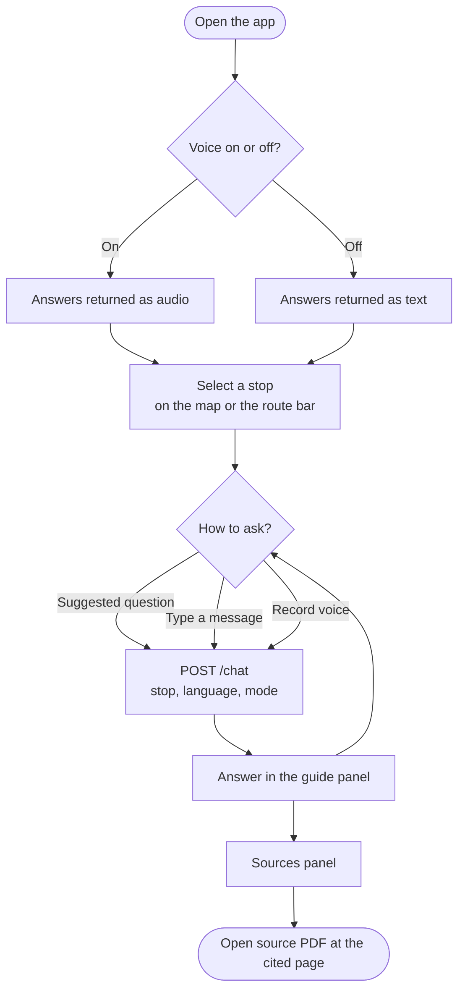

### 8.4 Frontend and Backend Communication

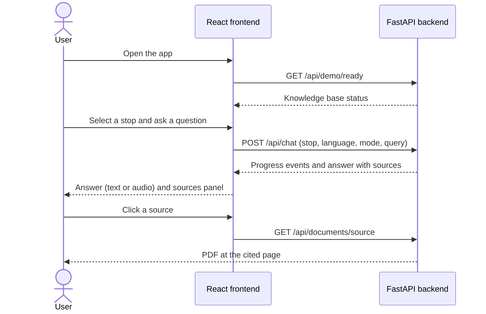

### 8.5 Frontend Development

The frontend runs on the Vite development server, which proxies `/api` requests to the backend (see section 3.3).

| Command (from `frontend/`) | Purpose |
| --- | --- |
| `npm run dev` | Start the development server |
| `npm run build` | Create the production build served by the container |
| `npm run lint` | Run ESLint |
| `npm test` | Run the unit tests |

## 9. Google Cloud Platform Deployment

Plinius is deployed to Google Cloud Platform (GCP) through GitHub Actions. The image is stored in Artifact Registry and deployed to Cloud Run as a Docker container. Prompts and documents live in Cloud Storage, retrieval chunks are served by a Qdrant virtual machine, and secrets are held in Secret Manager. As a result, the application itself is fully stateless.

### 9.1 Architecture

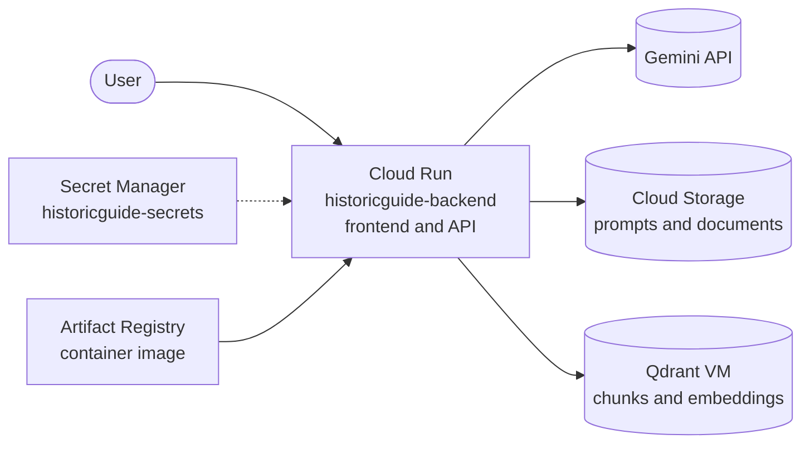

### 9.2 Services

| Service | Role |
| --- | --- |
| GitHub Actions | Builds the image and deploys the infrastructure |
| Artifact Registry | Stores the Docker image; only the two newest images are retained |
| Cloud Run | Runs the single container that serves the frontend (`/`) and the API (`/api`) |
| Cloud Storage | Holds the prompts (`prompts/`) and the source PDF documents (`docs/`) |
| Qdrant on Compute Engine | Virtual machine that stores the chunks and embeddings used for retrieval |
| Secret Manager | Holds the `historicguide-secrets` secret, which contains the application configuration |
| Cloud Logging and Monitoring | Centralized private logs and error alerts |
| Terraform | Defines all of the above as infrastructure as code |

### 9.3 Stateless Design

The Cloud Run container keeps no local state. Everything it needs is read at runtime from managed services:

- **Prompts and documents:** read from Cloud Storage, so the image contains neither the PDF corpus nor local databases.
- **Chunks and embeddings:** retrieved from the Qdrant virtual machine over the private network.
- **Configuration and credentials:** supplied by Secret Manager as the `APP_SECRETS_JSON` environment variable. The container authenticates to Google Cloud with its attached service account, so no key files are bundled.

Because of this, any instance can serve any request, and the knowledge base can be updated without rebuilding the image.

### 9.4 Continuous Deployment

Deployment runs from a single GitHub Actions workflow, triggered when a pull request from the `dev` branch is merged into `main`.

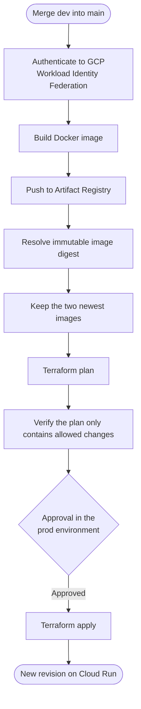

| Stage | Description |
| --- | --- |
| Authentication | GitHub authenticates to GCP with Workload Identity Federation; no service account keys are stored |
| Build and publish | The image is built for `linux/amd64`, pushed to Artifact Registry and resolved to an immutable digest. The build is skipped when no application source changed |
| Plan | Terraform plans the change and a plan checker rejects any unexpected resource change |
| Approval | The saved plan is reviewed and approved in the protected `prod` environment |
| Apply | Terraform applies that exact plan, deploying the digest to Cloud Run |

### 9.5 Cloud Run Configuration

| Setting | Value |
| --- | --- |
| Service | `historicguide-backend` in `europe-southwest1` |
| Resources | 2 CPU and 2 GiB of memory |
| Instances | Minimum 1 and maximum 1 |
| Access | Public (frontend and API) |
| Health check | Startup probe on `/api/health` |
| Network | Private subnet with private-range egress, used to reach the Qdrant VM |
| Environment | `ENV=GCP`, Qdrant host and port, project and region, and `APP_SECRETS_JSON` from Secret Manager |

### 9.6 On-Demand Qdrant Startup

The Qdrant virtual machine shuts down when idle to reduce cost. When the app is opened, the frontend checks `/api/demo/ready` and, if Qdrant is unreachable, calls `/api/demo/start` to wake the VM. Chat remains disabled until the collection is ready (see section 7.5).

For the full Google Cloud bootstrap, permissions and Terraform procedure, see the [infrastructure guide](infra/README.md).

## 10. Infrastructure as Code with Terraform

Plinius uses Terraform as its Infrastructure as Code (IaC) tool to define and deploy the cloud infrastructure. Changes are delivered through a workflow divided into two parts: first, the changes are planned and the image is built and pushed; then, after a human developer reviews the plan, it is applied. The workflow starts from a pull request merged from `dev` into `main`.

### 10.1 Two-Part Workflow

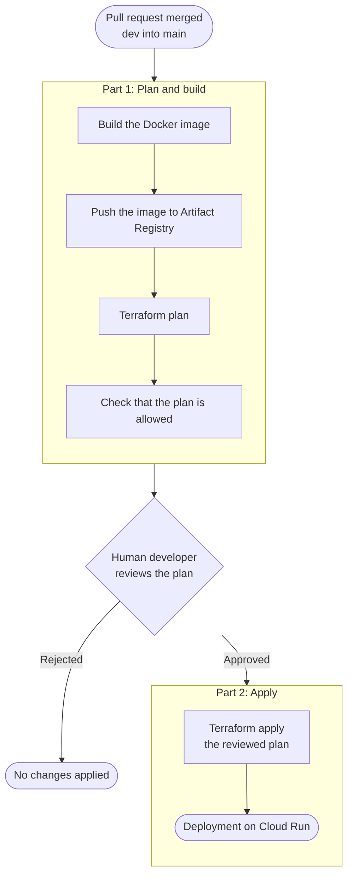

| Part | Job | What it does |
| --- | --- | --- |
| 1 | Build and plan | Builds and pushes the image, then runs the Terraform plan and verifies it. The plan is saved as an artifact |
| Review | Human approval | A developer reviews the plan in the protected `prod` environment |
| 2 | Apply | Applies that exact reviewed plan, so nothing changes between review and deployment |

The workflow runs only when a same-repository pull request from `dev` is merged into `main`. It does not run on a push, on an unmerged pull request or on a manual dispatch. It is defined in [.github/workflows/terraform-deploy.yml](.github/workflows/terraform-deploy.yml).

### 10.2 Repository Structure

| Path | Content |
| --- | --- |
| `infra/environments/prod/` | Production environment: module composition, variables, outputs and remote state backend |
| `infra/modules/storage/` | Cloud Storage bucket for prompts and documents |
| `infra/modules/secrets/` | Secret Manager secret (metadata only) |
| `infra/modules/artifact_registry/` | Docker repository and image retention policy |
| `infra/modules/cloudrun/` | Cloud Run service and public access |
| `infra/modules/logging/` | Private log bucket, log sink, error metric and monitoring alert |
| `scripts/check_infra_plan.py` | Plan checker that rejects unexpected changes |
| `scripts/registry_images.py` | Image tag selection and pruning |

### 10.3 Safety Controls

- **Reviewed plan:** the plan saved in part 1 is the one applied in part 2, after human approval.
- **Plan checker:** the plan is verified before it is uploaded and again before it is applied. It allows only the expected resources and rejects deletions, replacements, extra resources and unrelated changes.
- **Immutable image:** the image is resolved to a digest, so Cloud Run deploys exactly the image that was built.
- **Remote state:** Terraform state is stored in a Cloud Storage bucket under an isolated prefix, with state locking.
- **Keyless authentication:** GitHub authenticates to GCP with Workload Identity Federation; no service account keys are stored.
- **Protected resources:** the storage bucket and the secret use `prevent_destroy`, and secret values never enter the configuration, plans or state.
- **Serialized runs:** a concurrency group prevents two deployments from running at the same time.

For the one-time bootstrap, permissions and the complete procedure, see the [infrastructure guide](infra/README.md).

## 11. Author

Created by **Vicente Zambrano**.
